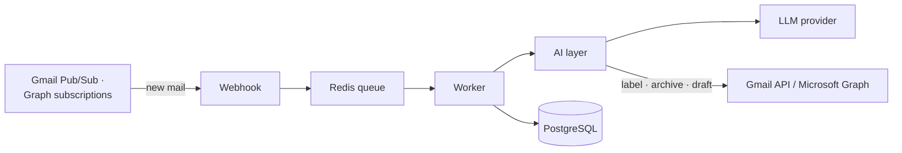

# Mail Pilot


> Describe how your inbox should be handled in plain English. Mail Pilot labels and archives mail, drafts replies in your voice, and tracks what still needs an answer.

Mail Pilot is an AI email assistant and a fast email client for Gmail and Outlook. The two halves work on their own or together:

- **The assistant** runs in the background on a Gmail or Microsoft 365 account and acts on every new email according to your rules.
- **The client** is a split inbox for web and desktop (Electron) that keeps all your accounts in one place, with keyboard-first compose.

Everything is self-hostable, and one command runs the whole stack locally without a single API key.

## Features at a glance

| Feature | What it does |
|---|---|
| **Plain-English rules** | Pair a prompt ("Emails I need to respond to…") with actions: label, archive, draft a reply, forward, mark read or call a webhook |
| **Default rule set** | To Reply, Awaiting Reply, FYI, Newsletter, Marketing, Calendar, Receipt, Notification and Cold Email, each with an on/off toggle |
| **Draft replies** | Written from your email history and knowledge base, saved to your drafts folder, never sent on their own |
| **Reply tracking** | *To Reply* and *Awaiting Reply* show what you owe and what you're waiting on |
| **Cold email blocker** | Labels and archives unsolicited outreach |
| **Test and history** | Try rules on real messages before turning them on, and see what the assistant did and why |
| **Chat assistant** | Ask it to handle today's inbox or suggest rules, from the app, Slack, Telegram or Microsoft Teams |
| **Meeting briefs** | Sent before calls with outside guests |
| **Inbox cleanup** | Bulk unsubscribe, bulk archive by sender category, and email analytics |
| **Smart filing** | Saves attachments to Google Drive or OneDrive |
| **Split inbox** | Tabs for To Reply, Newsletter, Calendar, Receipt and custom splits, across multiple Gmail and Outlook accounts |
| **Teams and billing** | Organizations with shared settings, a public API with API keys, and Stripe billing |
| **Model choice** | Pick a `provider:model` per task: default, economy, chat, nano and draft |

## How it works

1. New mail arrives as a push notification, through Gmail Pub/Sub or Microsoft Graph subscriptions.
2. The webhook drops the work on a Redis queue (BullMQ or QStash), off the request path.
3. A worker runs your rules: static conditions first, the LLM only when it is needed.
4. The matching actions (label, archive, draft) are applied through the provider API.

Gmail and Microsoft sit behind a single `EmailProvider` interface, so rules, cleanup and the assistant never talk to a provider SDK directly. The web and desktop clients share the same mail packages (`packages/mail-core`, `mail-react`, `mail-ui`, `mail-sqlite`).

In local mode every outside service (Google, Microsoft, the LLM, Stripe and email delivery) is replaced by an emulator, and the same code paths run in development, tests and production.



A few things we care about:

- **One mutation pipeline.** Every server action is validated with zod through `next-safe-action`, gets a scoped logger, and follows one error policy.
- **Schemas that LLMs accept.** Some providers reject `min`/`max` in structured output, so fields like action delays have a strict schema for users and an "LLM-safe" twin that moves the limits into the description.
- **A demo that can't leak.** The guest account is blocked from sending, billing, API keys and integrations both at the server-action level and in the middleware.

```ts
// apps/web/utils/demo.ts (trimmed)
export function assertDemoActionAllowed({ actionName, userEmail }) {
  if (isDemoUserEmail(userEmail) && DEMO_BLOCKED_ACTIONS.has(actionName)) {
    throw new SafeError(DEMO_BLOCKED_MESSAGE, 403);
  }
}
```

The interface is a quiet, dense workspace: neutral greys, one blue accent, and small coloured pills for what the assistant did (blue for *To Reply*, green for drafts, amber for archive). It follows your system's light or dark setting, and on phones the sidebar folds away and the inbox becomes a stacked list.
## Quick start

You'll need Node.js 24, pnpm 11 (`corepack enable`), Docker with Compose (or native PostgreSQL 16 and Redis), and macOS or Linux (WSL on Windows).

```bash
git clone <your-fork-url> mail-pilot
cd mail-pilot
pnpm install
pnpm local:start          # add --port 3001 if 3000 is taken
```

Open `http://localhost:3000/mail`.

The launcher starts PostgreSQL, Redis, the Google and Microsoft emulators, the billing, email and LLM emulators, and Next.js, applies migrations and waits until everything is ready. Use `--backend docker` or `--backend native` to choose how PostgreSQL and Redis run, and press **Ctrl-C** to stop.

### Try the demo

Go to `http://localhost:3000/login` and click **Try demo, no sign-up needed**. You land in a seeded Gmail inbox as `developer@example.com`. You can also sign in through the emulated Google (`developer@example.com`) or Microsoft (`developer@outlook.test`) accounts.

The guest demo blocks sending email, billing, API keys and other account-level actions. AI answers in local mode come from an emulator, so they show the flow, not the model's quality.

### Real Gmail and Outlook accounts

```bash
pnpm setup                # interactive wizard that writes apps/web/.env
pnpm dev
```

### Handy scripts

| Script | What it does |
|---|---|
| `pnpm local:start` | Full local stack with emulators |
| `pnpm dev` / `pnpm build` | Web app dev server / production build |
| `pnpm desktop` | Electron app in dev |
| `pnpm worker` | Background worker |
| `pnpm lint` / `pnpm fix` | Lint and format with Biome |

<details>
<summary><b>Environment variables</b></summary>

The full list is in `apps/web/.env.example`. The ones that matter most:

| Variable | Required | Description |
|---|---|---|
| `DATABASE_URL`, `DIRECT_URL` | Yes | PostgreSQL connection strings |
| `NEXT_PUBLIC_BASE_URL` | Yes | Public URL of the web app |
| `AUTH_SECRET` | Yes | Session signing secret |
| `EMAIL_ENCRYPT_SECRET`, `EMAIL_ENCRYPT_SALT` | Yes | Encrypt stored OAuth tokens |
| `INTERNAL_API_KEY`, `API_KEY_SALT`, `CRON_SECRET` | Yes | Internal calls, public API keys and cron jobs |
| `GOOGLE_CLIENT_ID`, `GOOGLE_CLIENT_SECRET`, `GOOGLE_PUBSUB_*` | For Gmail | OAuth app and Pub/Sub topic |
| `MICROSOFT_CLIENT_ID`, `MICROSOFT_CLIENT_SECRET` | For Outlook | Azure app registration |
| `REDIS_URL` or `REDIS_HTTP_URL` + `REDIS_HTTP_TOKEN` | Yes | Cache and queues |
| `LLM_API_KEY`, `DEFAULT_LLMS`, `DRAFT_LLMS`, ... | Yes | AI key and `provider:model` per task |
| `QUEUE_BACKEND`, `QSTASH_*` | No | Queue driver (BullMQ or QStash) |
| `SLACK_*`, `TELEGRAM_*`, `TEAMS_*` | No | Chat integrations |
| `STRIPE_*` | No | Billing |
| `NEXT_PUBLIC_DEMO_MODE`, `DEMO_USER_EMAIL` | No | Guest demo. Only with an emulated or throwaway mailbox |
| `NEXT_PUBLIC_BYPASS_PREMIUM_CHECKS` | No | Unlock premium features when self-hosting |

</details>

## Testing

```bash
pnpm test                                        # unit tests
pnpm test-integration                            # integration tests
pnpm -F mailpilot-web test:playwright:emulated   # browser tests on emulators
```

More than 1,300 test files cover the workspace. Unit tests sit next to the code, and integration, e2e and eval suites live in `apps/web/__tests__/`. Playwright runs the real app against the Google, Microsoft and LLM emulators, so mail flows are tested end to end without real accounts. AI evals (`pnpm -F mailpilot-web test-ai`, needs a real LLM key) check behaviour rather than exact wording.

## Where things live

```
apps/
├── web/          Next.js app: UI, API routes, AI, Prisma schema
├── desktop/      Electron client
├── worker/       background jobs
└── ...
packages/
├── cli/          setup and deploy CLI
├── mail-core/ mail-react/ mail-ui/ mail-sqlite/   shared email client
└── ...
docker/ charts/ copilot/   deployment
```

## Deploy

| Target | How |
|---|---|
| **Docker** | `docker-compose.yml` runs the web app, worker, cron, PostgreSQL and Redis; `docker/Dockerfile.prod` builds the image |
| **Kubernetes** | Helm chart in `charts/` |
| **AWS** | `pnpm setup-aws` (Copilot) or `pnpm setup-terraform` |
| **Vercel** | The web app, with managed PostgreSQL, Upstash Redis and QStash |

Before going live, create Google and Microsoft OAuth apps, set up Gmail Pub/Sub for push notifications, choose your LLM providers, and keep `NEXT_PUBLIC_DEMO_MODE` off.

## Stack

| Layer | Technology |
|---|---|
| Monorepo | pnpm 11 workspaces, Turborepo |
| Web | Next.js 16.4, React 19.3, TypeScript 6.0 |
| UI | Tailwind CSS, shadcn/ui, Radix, SWR, Jotai |
| Data | PostgreSQL with Prisma 7 |
| Auth | Better Auth (Google and Microsoft OAuth) |
| Queues | Redis with BullMQ, or Upstash QStash |
| AI | Vercel AI SDK with a provider per task |
| Billing | Stripe |
| Tests | Vitest, Playwright |

## What's next

- Sample analytics and sender data in the local demo.
- Smarter draft replies that learn from sent mail.
- More chat channels and richer actions from Slack and Teams.
- Shared inboxes and team assignment in the client.
