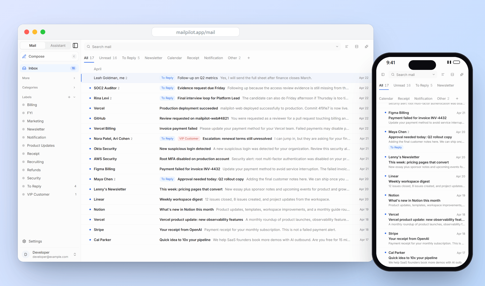
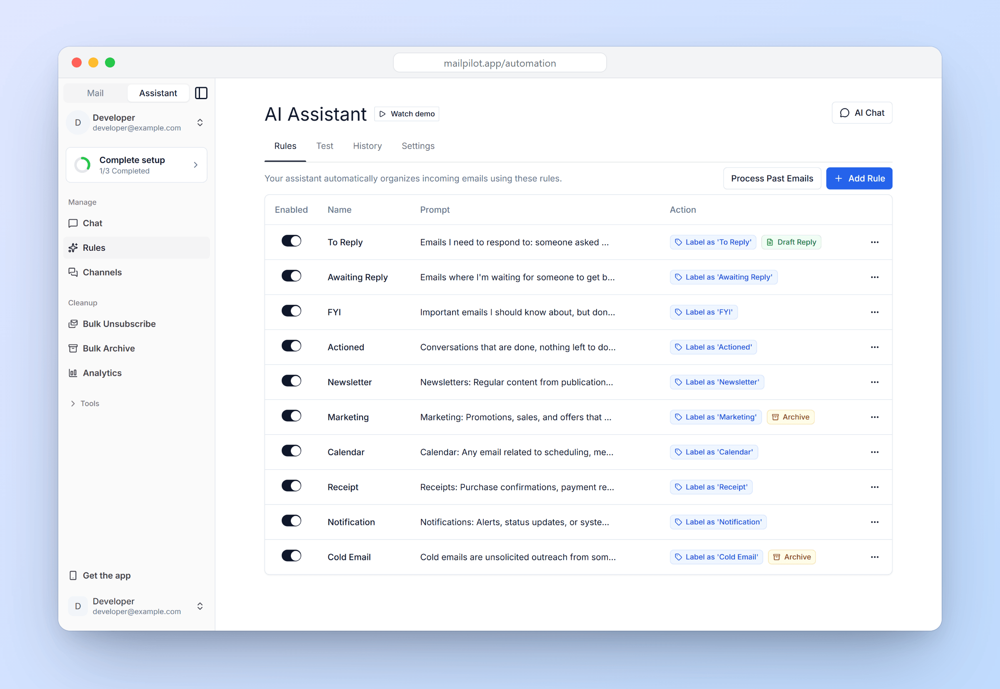
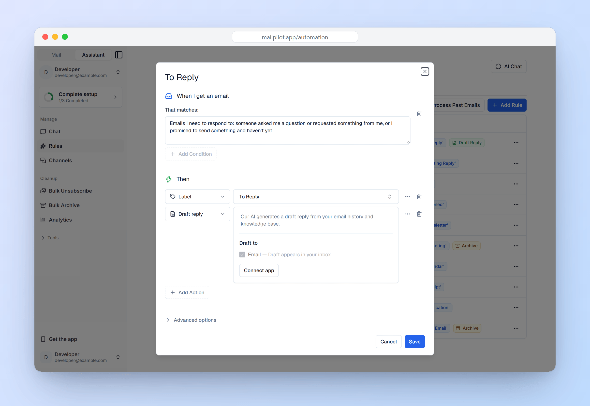
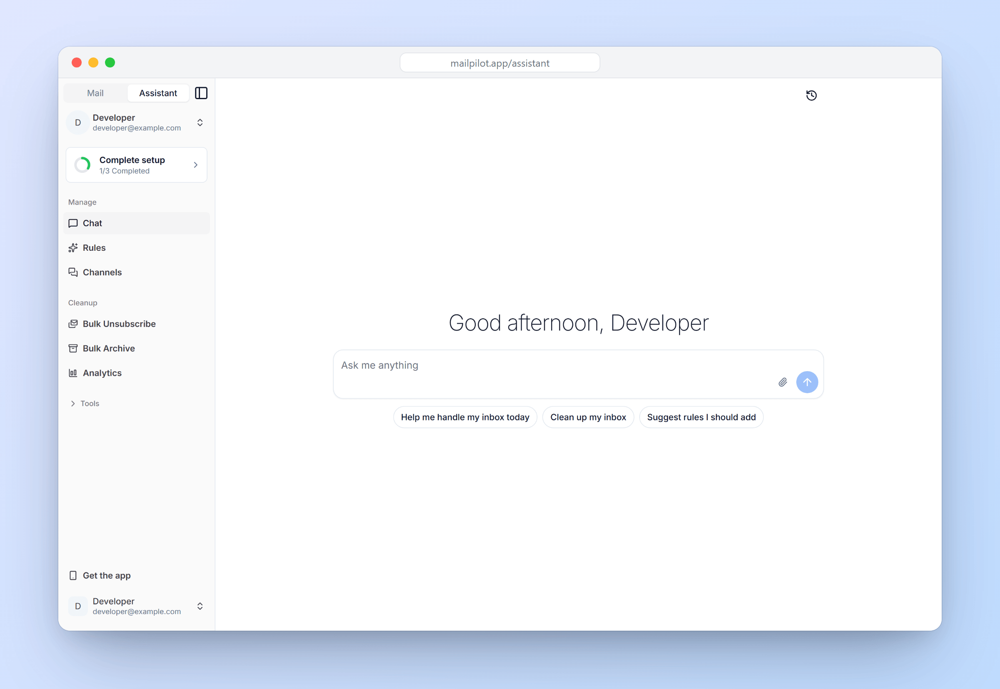
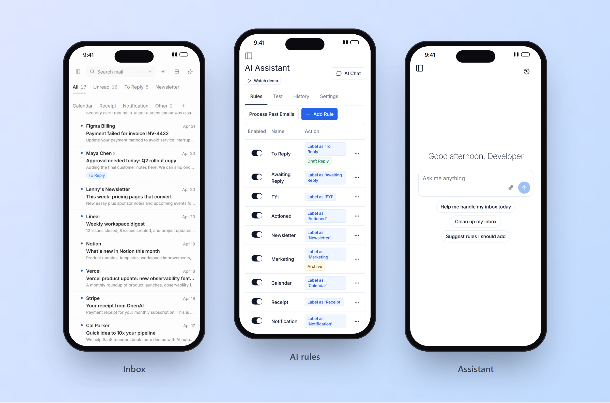
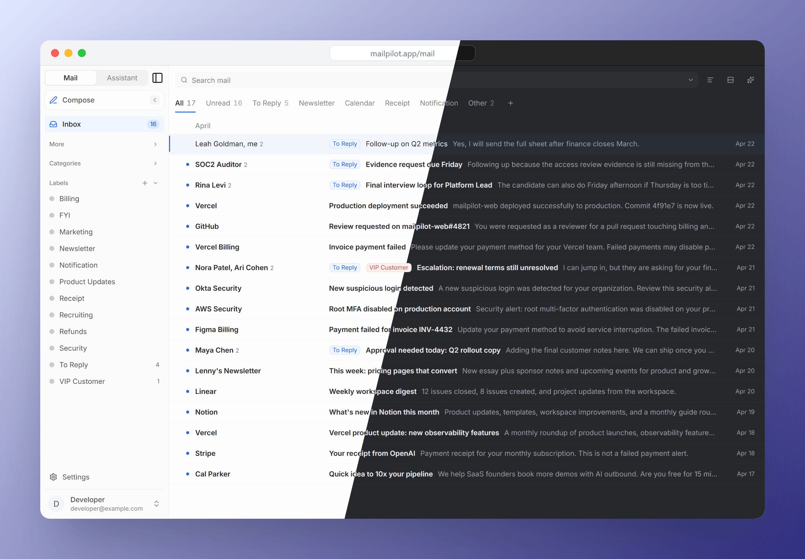
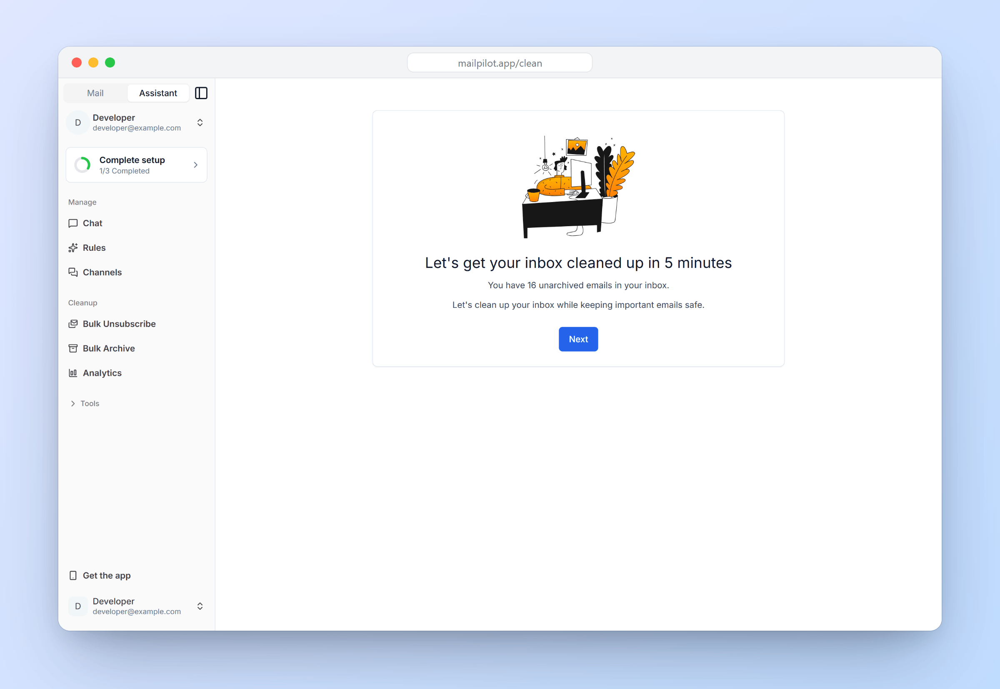
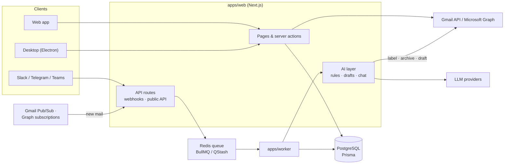

<div align="center">

# Mail Pilot

**An AI email assistant and a fast email client for Gmail and Outlook. Describe how your inbox should be handled in plain English, and Mail Pilot labels and archives mail, drafts replies in your voice, and tracks what still needs an answer.**


[Features](#features) · [Design](#design) · [Screenshots](#screenshots) · [Tech stack](#tech-stack) · [Getting started](#getting-started)

</div>

<br>

<picture>
  <source media="(prefers-color-scheme: dark)" srcset="readme/hero-dark.png">
  
</picture>

## Overview

Mail Pilot has two parts, and each works on its own:

- **The assistant** runs in the background on a Gmail or Microsoft 365 account. Rules written in plain English decide what happens to each new email: label it, archive it, draft a reply, forward it, or mark it as cold outreach. It also tracks threads that need your reply or are waiting on someone else, and it cleans up newsletters and old mail in bulk.
- **The client** is a split inbox for web and desktop (Electron). It keeps all your accounts in one place and has keyboard-first compose.

Everything is self-hostable. A single command, `pnpm local:start`, runs the whole stack against local emulators for Google, Microsoft, the LLM, billing and email delivery, so no OAuth credentials or API keys are needed to try it.

> **Portfolio demo build.** This `demo` branch is what runs at [mailpilot.arealjagema.com](https://mailpilot.arealjagema.com): the web app with in-memory data and no outside services. The full app is on [`main`](../../tree/main).

## Portfolio demo

The live demo needs no database, Redis, Google account or LLM key. Built with `DEMO_IN_MEMORY=true` (set on the Vercel project, together with `NEXT_PUBLIC_BASE_URL`; `apps/web/vercel.json` holds the install and build commands); route-level `maxDuration` settings are removed on this branch, since the demo does no slow work and every route then shares one function configuration, the server starts everything inside its own process before it takes requests:

- **Database:** [PGlite](https://pglite.dev) in memory, served to Prisma over a loopback socket. Its schema is generated from `prisma/schema.prisma` at build time (`pnpm demo:schema`).
- **Mailbox and AI:** the same Google and LLM emulators local mode uses, on loopback ports. Nothing contacts Gmail or an AI API.
- **Redis:** a small in-memory store behind the same HTTP API the app uses for Upstash.
- **Sample data:** the guest user, mailbox and a public booking page (`/book/developer`, weekdays 9:00-17:00) are seeded at startup with fixed ids, and mail dates move forward so the newest thread is from yesterday. Every serverless instance seeds the same data, and the shared guest session is valid on all of them. Changes stay in the instance that made them and reset on cold start.

**Try demo** on the login page signs you in as the guest. Provider sign-in and sign-up are disabled. No environment variables are required; `AUTH_SECRET` is optional. To run the demo build locally:

```bash
pnpm install
DEMO_IN_MEMORY=true NEXT_PUBLIC_BASE_URL=http://localhost:3000 pnpm -F mailpilot-web build
DEMO_IN_MEMORY=true NEXT_PUBLIC_BASE_URL=http://localhost:3000 pnpm -F mailpilot-web start
```

## Try the demo locally

Run it locally (see [Getting started](#getting-started)) and open `http://localhost:3000/login`. Local mode turns on the guest demo: click **Try demo, no sign-up needed** to land in a seeded Gmail inbox as `developer@example.com`. You can also sign in through the emulated Google (`developer@example.com`) or Microsoft (`developer@outlook.test`) accounts.

The guest demo blocks sending email, billing, API keys and other account-level actions. AI responses come from a local emulator and are canned, so local mode shows how the app flows, not how good the model is.

## Features

### Rules in plain English

Each rule pairs a prompt ("Emails I need to respond to…") with actions: label, archive, draft a reply, forward, mark read or call a webhook. The default set covers To Reply, Awaiting Reply, FYI, Newsletter, Marketing, Calendar, Receipt, Notification and Cold Email, and each one can be switched off with a toggle.

<picture>
  <source media="(prefers-color-scheme: dark)" srcset="readme/rules-dark.png">
  
</picture>

### A rule editor that reads like a sentence

"When I get an email that matches… then…". Conditions and actions are stacked cards, so a rule can label a thread *and* draft a reply. Drafts are written from your email history and knowledge base and land in your drafts folder, never sent on their own.

<picture>
  <source media="(prefers-color-scheme: dark)" srcset="readme/rule-dark.png">
  
</picture>

### An assistant you can talk to

Ask the assistant to handle today's inbox, clean up, or suggest new rules. The same chat is available from Slack, Telegram and Microsoft Teams, and it can send meeting briefs before calls with outside guests.

<picture>
  <source media="(prefers-color-scheme: dark)" srcset="readme/assistant-dark.png">
  
</picture>

### Everything else

**AI assistant**
- **Reply tracking.** The *To Reply* and *Awaiting Reply* labels show which threads you owe an answer and which are waiting on someone else.
- **Cold email blocker** that labels and archives unsolicited outreach.
- **Test and history.** Try rules against real messages before turning them on, and see what the assistant did and why.
- **Smart filing** of attachments to Google Drive or OneDrive.

**Inbox cleanup**
- Bulk unsubscribe from senders you never read, with optional archive on unsubscribe.
- Bulk archive by sender category (newsletters, marketing, receipts, notifications).
- Email analytics: received, sent, read and archived volume over time, plus top senders.

**Email client**
- A split inbox with tabs for To Reply, Newsletter, Calendar, Receipt and custom splits.
- Multiple Gmail and Outlook accounts, labels, search and keyboard shortcuts.
- Web and an Electron desktop app (`apps/desktop`).

**Platform**
- Organizations with shared settings, a public API with API keys, and Stripe billing.
- Choose AI providers per task: default, economy, chat, nano and draft models, each set as `provider:model`.

## Design

- **A quiet, dense workspace.** Neutral greys, one blue accent for primary actions and the active tab, and small coloured pills for AI labels (blue for *To Reply*, red for *VIP Customer*, green for drafts, amber for archive). The colour is reserved for what the assistant did.
- **Split inbox.** Tabs across the top (All, Unread, To Reply, Newsletter and so on) show counts, so you see what needs you before you open anything.
- **Two modes, one sidebar.** A Mail / Assistant switch at the top of the sidebar flips between the client and the assistant's rules, chat and cleanup tools.
- **Light and dark.** The theme follows the system setting by default, and every screen, including dialogs and label pills, has a dark variant.
- **Responsive.** On phones the sidebar folds away behind a toggle, the inbox becomes a stacked list with the sender, subject and preview on separate lines, and the rules table drops the prompt column.
- **Built on shadcn/ui and Radix,** so menus, dialogs and selects are keyboard accessible and focus-managed.

<picture>
  <source media="(prefers-color-scheme: dark)" srcset="readme/mobile-dark.png">
  
</picture>

<p align="center"></p>

## Screenshots

| | |
| --- | --- |
| <br>**Inbox cleaner.** A guided clean-up that archives old mail while keeping important threads. | <br>**Rule editor.** Conditions and actions for a single rule. |

All screenshots come from the running app in local mode with the seeded demo mailbox: desktop at 1440×900 and mobile at 390×844 (iPhone user agent), both at retina resolution.

## Tech stack

| Layer | Technology | Why |
| --- | --- | --- |
| Monorepo | pnpm 11 workspaces, Turborepo | Web, desktop, worker and shared mail packages build and test together |
| Web app | Next.js 16.4 (App Router, Turbopack), React 19.3, TypeScript 6.0 | Server components and server actions in one deployable |
| UI | Tailwind CSS 3.4, shadcn/ui, Radix, SWR 2.5, Jotai 3 | Accessible primitives, cached client fetching, small atomic state |
| Data | PostgreSQL with Prisma 7.10 | Typed queries and versioned migrations |
| Auth | Better Auth 1.7 (Google and Microsoft OAuth) | The same OAuth grant powers sign-in and mailbox access |
| Queues and cache | Redis, BullMQ 6 or Upstash QStash, Upstash Redis HTTP | Webhook work runs off the request path; serverless-friendly option |
| AI | Vercel AI SDK 7 with configurable providers per task | Swap models per job (draft, chat, nano) without code changes |
| Mutations | Server actions with `next-safe-action` 8.7 and zod 4.6 | Validated input, shared auth context, one error policy |
| Billing | Stripe 23 | Subscriptions and seats |
| Desktop | Electron | Reuses the shared mail packages |
| Tests | Vitest 4.1, Playwright 1.62 (against emulated providers) | Fast unit tests plus real end-to-end mail flows |
| Lint and format | Biome with Ultracite | One fast tool for both |
| Deploy | Docker, Helm chart, AWS Copilot, Terraform via the CLI | Self-host anywhere |

## Architecture



- **New mail arrives as push notifications** (Gmail Pub/Sub or Microsoft Graph subscriptions). The webhook queues the work, and a worker runs the matching rules through the AI layer, then applies the actions through the provider API.
- **One `EmailProvider` interface** wraps Gmail and Microsoft, so features never branch on the provider except at the boundary.
- **Shared mail packages** (`packages/mail-core`, `mail-react`, `mail-ui`, `mail-sqlite`) power both the web and desktop clients.
- **Local mode swaps every external service for an emulator** (Google, Microsoft, LLM, Stripe, email delivery). The same code paths run in development, Playwright tests and production.

## Engineering highlights

- **One mutation pipeline.** Every server action goes through a `next-safe-action` client that validates input with zod, attaches a scoped logger (request, user and account ids), and applies a single error policy. Expected rejections (`SafeError`, provider rate limits) are logged as warnings and shown to the user. Anything else is logged as an error and reported, and the logger is flushed with `after()` so the response is not delayed.
- **Provider-agnostic mail layer.** `EmailProvider` (`utils/email/types.ts`) is one interface implemented for Gmail and Microsoft Graph: archive, label, draft, bulk-archive by sender and more. Rules, cleanup and the assistant call the interface, never a provider SDK directly.
- **Rules as a staged pipeline.** `runRules` (`utils/ai/choose-rule/run-rules.ts`) prepares the rule set, finds matching rules (static conditions first, the LLM only when needed), then keeps conversation and calendar rules consistent across a thread before any action runs.
- **Schemas that work with LLMs.** Structured output from some providers rejects `min`/`max` constraints, so fields such as action delays have a strict schema for user input and an "LLM-safe" twin that moves the limits into the description.
- **A demo that cannot leak.** The guest demo is blocked at two layers: a named list of server actions (sending, billing, API keys, account deletion, integrations) and a check on API routes in the middleware.
- **Tests at every level.** More than 1,300 test files across the workspace: Vitest unit tests next to the code, integration and database suites, Playwright against emulated Google, Microsoft and LLM providers, and AI evals that check behaviour rather than exact wording.
- **Formatting and linting** with Biome (Ultracite preset), and strict TypeScript across apps and packages (`pnpm typecheck:packages`).

```ts
// apps/web/utils/demo.ts
// Server actions with an effect outside the demo mailbox: sending mail,
// billing, account deletion, connecting outside services, and invitations.
const DEMO_BLOCKED_ACTIONS = new Set([
  "claimPremiumAdmin",
  "createApiKey",
  "deleteAccount",
  // …
]);

export function assertDemoActionAllowed({
  actionName,
  userEmail,
}: {
  actionName: string;
  userEmail: string | null | undefined;
}) {
  if (isDemoUserEmail(userEmail) && DEMO_BLOCKED_ACTIONS.has(actionName)) {
    throw new SafeError(DEMO_BLOCKED_MESSAGE, 403);
  }
}
```

```ts
// apps/web/utils/actions/rule.validation.ts
export const delayInMinutesSchema = z
  .number()
  .min(1, "Minimum supported delay is 1 minute")
  .max(NINETY_DAYS_MINUTES, "Maximum supported delay is 90 days")
  .nullish();

// LLM-safe version: no .min()/.max() (Anthropic structured output rejects them).
// Constraints are conveyed via .describe() instead.
export const delayInMinutesLlmSchema = z
  .number()
  .nullish()
  .describe(
    `Minutes to wait before executing this action (minimum 1, maximum ${NINETY_DAYS_MINUTES}). Only add when the user asks for a delay.`,
  );
```

## Getting started

### Prerequisites

- Node.js 24 and pnpm 11 (pinned in `package.json`; `corepack enable` installs it)
- Docker with Compose, or native PostgreSQL 16 and Redis
- macOS or Linux (on Windows, use WSL)

### Run locally with emulators

```bash
git clone <your-fork-url> mail-pilot
cd mail-pilot
pnpm install
pnpm local:start          # add --port 3001 if 3000 is taken
```

Then open `http://localhost:3000/mail`. The launcher starts PostgreSQL, Redis and its HTTP proxy, the Google and Microsoft emulators, the billing, email-delivery and LLM emulators, and Next.js. It applies migrations and waits until everything is ready. Generated credentials and seed data live in `.context/local-dev/`, and database data survives restarts. Use `--backend docker` or `--backend native` to choose how PostgreSQL and Redis run. Press **Ctrl-C** to stop everything.

### Run against real providers

```bash
pnpm setup                # interactive wizard that writes apps/web/.env
pnpm dev
```

### Environment

<details>
<summary>All environment variables</summary>

`apps/web/.env.example` lists every variable. The main ones:

| Variable | Required | Description |
|---|---|---|
| `DATABASE_URL`, `DIRECT_URL` | Yes | PostgreSQL connection strings |
| `NEXT_PUBLIC_BASE_URL` | Yes | Public URL of the web app |
| `AUTH_SECRET` | Yes | Session signing secret |
| `EMAIL_ENCRYPT_SECRET`, `EMAIL_ENCRYPT_SALT` | Yes | Encrypt stored OAuth tokens |
| `INTERNAL_API_KEY`, `API_KEY_SALT`, `CRON_SECRET` | Yes | Internal calls, public API keys and cron jobs |
| `GOOGLE_CLIENT_ID`, `GOOGLE_CLIENT_SECRET`, `GOOGLE_PUBSUB_*` | For Gmail | OAuth app and Pub/Sub topic for push notifications |
| `MICROSOFT_CLIENT_ID`, `MICROSOFT_CLIENT_SECRET`, ... | For Outlook | Azure app registration |
| `REDIS_URL` or `REDIS_HTTP_URL` + `REDIS_HTTP_TOKEN` | Yes | Redis for cache and queues |
| `QUEUE_BACKEND`, `QSTASH_*` | No | Queue driver (BullMQ or QStash) |
| `LLM_API_KEY`, `DEFAULT_LLMS`, `ECONOMY_LLMS`, `CHAT_LLMS`, `NANO_LLMS`, `DRAFT_LLMS` | Yes | AI provider key and `provider:model` choices per task |
| `SLACK_*`, `TELEGRAM_*`, `TEAMS_*` | No | Chat integrations |
| `STRIPE_*` | No | Billing |
| `NEXT_PUBLIC_DEMO_MODE`, `DEMO_USER_EMAIL` | No | Guest "Try demo" sign-in. Enable only with an emulated or throwaway mailbox |
| `NEXT_PUBLIC_BYPASS_PREMIUM_CHECKS` | No | Unlock premium features when self-hosting |

</details>

## Scripts

<details>
<summary>All scripts</summary>

Run from the repository root:

| Script | What it does |
|---|---|
| `pnpm local:start` | Full local stack with emulators |
| `pnpm dev` / `pnpm build` | Web app dev server / production build (Turborepo) |
| `pnpm desktop` / `pnpm desktop:dist` | Electron app in dev / packaged |
| `pnpm worker` | Background worker |
| `pnpm test` | Web app unit tests (Vitest) |
| `pnpm test-integration` / `pnpm test-db` | Integration and database tests |
| `pnpm test:packages` / `pnpm typecheck:packages` | Tests and type checks for workspace packages |
| `pnpm lint` / `pnpm check` / `pnpm fix` | Linting and Biome formatting |
| `pnpm setup` | CLI setup wizard (also `setup-aws`, `setup-terraform`) |
| `pnpm -F mailpilot-web test:playwright:emulated` | Browser tests against emulated providers |

</details>

## Project structure

<details>
<summary>Project tree</summary>

```
apps/
├── web/                 Next.js app: UI, API routes, AI, Prisma schema
│   ├── app/             routes, including (app)/[emailAccountId]/ features
│   ├── utils/           AI rules, providers, actions, queues
│   ├── prisma/          schema and migrations
│   └── __tests__/       integration, e2e, eval and Playwright suites
├── desktop/             Electron client
├── worker/              background jobs
├── unsubscribe-worker/  unsubscribe automation
└── image-proxy/         safe image loading for email bodies
packages/
├── cli/                 setup and deploy CLI
├── api/                 public API client
├── mail-core/ mail-react/ mail-ui/ mail-sqlite/   shared email client
├── email-editor/ transactional-email/             compose and outgoing mail
└── tinybird/ ...        analytics and shared config
docker/ charts/ copilot/ deployment (Dockerfiles, Helm, AWS)
```

</details>

## Testing & quality

```bash
pnpm test                                        # unit tests
pnpm test-integration                            # integration tests
pnpm -F mailpilot-web test:playwright:emulated   # browser tests on emulators
pnpm -F mailpilot-web test-ai                    # AI evals (needs a real LLM key)
```

- More than 1,300 test files. Unit tests sit next to the code they cover, and integration, e2e and eval suites live in `apps/web/__tests__/`.
- Playwright runs the real app against the Google, Microsoft and LLM emulators, so mail flows are tested end to end without real accounts.
- AI evals check behaviour (for example, "does not invent payment status") rather than exact wording.

## Deployment

- **Docker:** `docker-compose.yml` runs the web app, worker, cron, PostgreSQL and Redis. `docker/Dockerfile.prod` builds the production image.
- **Kubernetes:** a Helm chart lives in `charts/`.
- **AWS:** `pnpm setup-aws` (Copilot) or `pnpm setup-terraform`.
- **Vercel** works for the web app, with a managed PostgreSQL database, Upstash Redis and QStash.

For production, create Google and Microsoft OAuth apps, set up Gmail Pub/Sub for push notifications, choose your LLM providers, and keep `NEXT_PUBLIC_DEMO_MODE` off.

## Roadmap

- Sample analytics and sender data in the local demo, so the Bulk Unsubscribe and Analytics pages are populated out of the box.
- Smarter draft replies that learn from sent mail over time.
- More chat channels and richer actions from Slack and Teams.
- Shared inboxes and team assignment in the client.